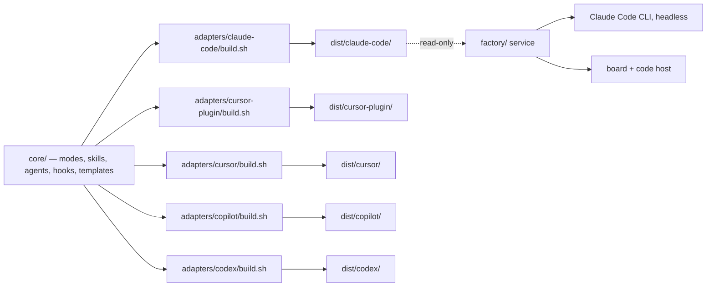

# System Architecture: pai-orbit
Last updated: 2026-11-26
Status: declared

## Services

| Service | Path / Repo | Stack | Purpose |
|---------|-------------|-------|---------|
| core | `plugins/pai-orbit/core/` | Markdown (modes/skills/agents) + bash (hooks) | Tool-agnostic source of truth for all modes, skills, agents, hooks, templates |
| claude-code adapter | `plugins/pai-orbit/adapters/claude-code/` → `dist/claude-code/` | bash build script | Full-fidelity compile of core to the Claude Code plugin format |
| cursor-plugin adapter | `plugins/pai-orbit/adapters/cursor-plugin/` → `dist/cursor-plugin/` | bash build script | Cursor plugin (rules, skills, commands, agents, hooks) |
| cursor adapter (legacy) | `plugins/pai-orbit/adapters/cursor/` → `dist/cursor/` | bash build script | Lossy `.cursor/rules/*.mdc` compile |
| copilot adapter | `plugins/pai-orbit/adapters/copilot/` → `dist/copilot/` | bash build script + Node install CLI | Compiles 31 invokable prompts, 5 auto-attaching instructions files, and the `.github/copilot-instructions.md` rule book, with an `npx` installer; hooks degrade to advisory text + opt-in pre-commit |
| codex adapter | `plugins/pai-orbit/adapters/codex/` → `dist/codex/` | bash build script + Node install CLI | Full-parity native compile (skills, hooks, subagents, `AGENTS.md`) with `npx` installer |
| factory | `factory/` | Node 18+ (no dependencies), Docker image | **Runtime service.** Runs orbit's modes unattended from backlog to release by starting the Claude Code CLI headless with `dist/claude-code/` loaded. Proposed — see `docs/decisions/2026-11-26-agentic-factory-in-repo-service.md` |

## Communication

| From | To | Protocol | Notes |
|------|----|----------|-------|
| top-level `build.sh` | each `adapters/*/build.sh` | shell invocation | Discovers and runs every adapter automatically |
| adapter build.sh | `core/` | filesystem read | Reads `${CORE_DIR:-../../core}` |
| adapter build.sh | `dist/<tool>/` | filesystem write | Writes `${DIST_DIR:-../../dist/<tool>}`, which is committed |
| factory | `dist/claude-code/` | filesystem read (`--plugin-dir`) | Read-only. The factory never reads `core/` or `adapters/` and holds no mode text |
| factory | Claude Code CLI | child process (`claude -p`, JSON result) | One process per stage; receives the model credential only |
| factory | board / code host | `gh` CLI (GitHub) or local files | Orchestrator only; the agent process has no board or code-host credential |
| factory | chat | HTTPS webhook, outbound only | Alerts that link to the ticket; nothing is read from chat |

## Data Stores

The plugin pipeline has none — it is static content (markdown/bash in, markdown/bash out).

The factory service keeps files on one volume, with no database, cache, or queue:

| Store | Contents | If lost |
|-------|----------|---------|
| `runs/<ticket>/state.json` | Stage, session ids, cost, timers | Rebuilt from the board and the ticket branch; the current stage restarts |
| `runs/<ticket>/events.jsonl` | Append-only audit trail | Audit history for that ticket is lost |
| `workspaces/<ticket>/` | One clone per ticket | Re-cloned from the pushed ticket branch |
| agent session store | Claude sessions, for resuming a paused stage | The paused stage runs again from the start |

The board and the ticket branch are the source of truth for what was produced.

## Data Flow

## System Boundaries

**Inside this system:** `core/`, `adapters/*/`, `dist/*/`, `factory/`, and `docs/` in this repo.

**Outside this system (not owned, treated as external):**
- The Claude Code host application/runtime that loads the plugin
- GitHub (Issues, Projects v2) — used as the board, not owned by this repo
- The Claude Code plugin marketplace mechanism (`marketplace.json` resolution)
- The model provider, and the board, code host and chat tool a factory deployment is pointed at
- The server or Docker host a factory deployment runs on
- Consuming target-project repos — they install `dist/claude-code/` (or another adapter's bundle) and generate their own `.claude/` config via `/setup`; this repo has no visibility into or control over that generated config

## Open Questions

- [ ] The Agentic Factory makes this repo contain a runtime service for the first time. Its home (`factory/` here, or its own repo) is proposed, not ratified — see `docs/decisions/2026-11-26-agentic-factory-in-repo-service.md`. Owner: Chetan Sharma and team.
- [ ] Factory tickets are separated by directory inside one container, not by one container per ticket — see "Known limits" in `docs/features/agentic-factory/design.md`.

- [x] ~~`constraints.md` rule 6 requires full adapter parity, but `cursor` (legacy) is documented as "lossy" and `codex` as "experimental" today — both are known to fall short. Bring them to parity, or revisit the rule.~~ — **Partially resolved 2026-07-30 by the codex adapter upgrade.** Codex is now full-parity (native skills, hooks, subagents, npx installer) — see `docs/decisions/2026-07-19-codex-adapter-decisions.md`. `cursor` (legacy) remains a documented lossy path retained only for teams that cannot install the `cursor-plugin` build; the Cursor plugin adapter is full-parity and is the recommended install for Cursor users. Rule 6 is now met by all recommended install paths (`claude-code`, `cursor-plugin`, `codex`); the legacy `cursor` fallback is a deliberate documented exception.
- [x] ~~`kiro-power` ships with no agent or hook fidelity — accepted at introduction per `docs/decisions/2026-08-18-add-kiro-power-adapter.md`; revisit when Kiro gains an agent/hook-equivalent primitive.~~ — **Resolved 2026-09-14 by removing the adapter.** Rather than carry the gap indefinitely, `kiro-power` was withdrawn — see `docs/decisions/2026-09-14-remove-kiro-power-adapter.md`. Kiro is no longer a supported target; Kiro users have no pai-orbit install path.
- [ ] `/build` sub-agent worktree isolation is enforced only on `claude-code` (`isolation: "worktree"`); codex, cursor-plugin and copilot have no per-sub-agent worktree flag, so they keep the generic guidance — a recorded rule 6 exception, see `docs/decisions/2026-10-08-claude-code-only-build-subagent-rules.md`. Model tiering is portable and is tracked in #84 for the other adapters. Revisit when another tool adds a per-sub-agent isolation primitive.
