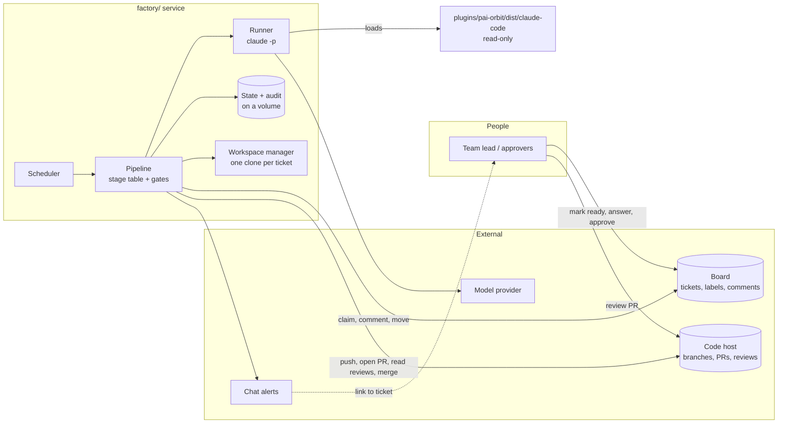
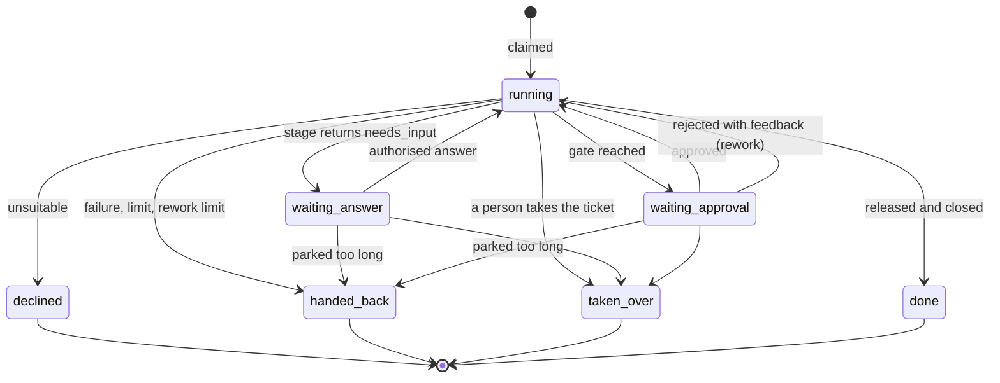

Status: Design proposed — decisions taken by delegation on 2026-11-26; ADRs await team ratification
Issue: none (standalone, local only)
Analysis: none needed — purely additive. `core/` and `dist/` are not changed (see decision 2).
ADRs:
- `docs/decisions/2026-11-26-agentic-factory-in-repo-service.md`
- `docs/decisions/2026-11-26-agentic-factory-unattended-contract.md`
- `docs/decisions/2026-11-26-agentic-factory-gates-by-credential-separation.md`

# Design: Agentic Factory

## How this design was decided

The requester asked for the work to be completed end to end without stopping for input, and for
sub-agents to settle the points that would normally be put to them. `/design` normally confirms each
decision with a person. Here each decision area was put to an independent sub-agent with the
requirements and the repo, and the recommendation was adopted. Every ADR is therefore marked
`proposed`, not `accepted`. The decision on where the factory lives was explicitly left open by the
requester for a team discussion; decision 1 is a proposal for that discussion, and it is reversible.

Facts about the Claude CLI were checked against the installed CLI (`claude --help`, v2.1.308) and
the official documentation, not taken from memory.

## Overview

The factory is a small Node service. It polls a board, claims eligible tickets, and for each ticket
runs orbit's modes one stage at a time by starting the Claude Code CLI headless with the built
pai-orbit plugin loaded. It never contains mode text of its own. An extra instruction file, the
**unattended contract**, tells the agent how to behave when no person is present and makes every
stage end with a structured result. The orchestrator, not the agent, pushes branches, opens pull
requests, posts comments, merges, and starts releases.



## Decisions

| # | Area | Chosen | Why |
|---|---|---|---|
| 1 | Where it lives | A new top-level `factory/` service in this repo that reads `plugins/pai-orbit/dist/claude-code/` only | One commit pins prompts and orchestrator together, so a prompt fix is made once. `core/` and `dist/` do not change, so rules 2 and 7 are untouched. **Proposed; the team discussion can still move it to its own repo — only the path to the plugin changes.** |
| 2 | Running gated modes unattended | Modes are not edited. The factory appends `factory/contract/unattended.md` to the system prompt and requires a JSON result that matches `factory/contract/stage-result.schema.json` | Zero diff in `core/` and `dist/`, so AC-32 is provable with `git diff`. Editing each mode would change every adapter's output. |
| 3 | Run state | The board and the ticket branch are the truth. A small per-ticket `state.json` and an append-only `events.jsonl` on a volume hold what those cannot (session ids, cost, timers) | No database. If the volume is lost the factory restarts the current stage from the branch; only cost history is lost. |
| 4 | Stack | Node 18+, no runtime dependencies, tests on `node:test`. The runner starts `claude -p` as a child process | Node is already required by the repo's installer. A child process is the same artefact developers run and can be killed when a limit is hit. The Agent SDK can replace it later behind the same interface. |
| 5 | Isolation and gates | One clone, one branch, and one session store per ticket. The agent process gets the model credential only. The orchestrator holds the board and code-host credentials and performs every write | The two fixed gates cannot be bypassed by the agent because it has nothing to merge or release with. |
| 6 | Release | A separate, serialised step per project that covers every merged ticket whose release is approved | Release steps (version bump, tag) are per release, not per ticket, and would collide across parallel tickets. |
| 7 | Questions | Batched per stage and posted as one ticket comment | A person answers once per stage instead of once per question. `/groom`'s one-at-a-time confirmation exists to stop silent bulk approval by a person; here every auto-decision must cite the ticket or a recorded answer instead. |

## The stage table

| # | Stage | Run by | Orbit mode | Completes when | Gate after |
|---|---|---|---|---|---|
| 1 | intake | orchestrator | — | Ticket claimed, intake size and sensitivity checks pass | — |
| 2 | groom | agent | `/groom` | `requirements.md` committed | requirements (optional) |
| 3 | design | agent | `/design` | `design.md` (+ ADRs) committed; after-design size check passes | design (optional) |
| 4 | build | agent | `/build` | Code and docs committed | — |
| 5 | test | agent | `/test` | `test-plan.md` committed, suite green | — |
| 6 | playwright | agent | `/playwright` | e2e files committed (skipped unless enabled) | — |
| 7 | review | agent | `/review` | Self-review findings fixed or reported (can be switched off) | — |
| 8 | pr | orchestrator | — | Branch pushed, pull request open | **merge (fixed)** |
| 9 | merge | orchestrator | — | Pull request merged | **release (fixed)** |
| 10 | release | agent, serialised | `/release` | Configured release steps done up to the release level | — |
| 11 | done | orchestrator | — | Ticket closed | — |

A stage is complete only when its output is committed and pushed on the ticket branch. That is the
restart checkpoint (REQ-19).

### Starting from an already groomed ticket

A ticket carries exactly one start label, added by a person: `factory-ready` for a raw ticket, or
`factory-groomed` for one a person has already groomed. Either label makes the ticket eligible, and
claiming it removes both, so a ticket is never picked up twice. For a groomed ticket the factory
looks for the requirements at intake instead of writing them:

1. a path of the form `<docs root>/features/<name>/requirements.md` in the ticket text, then
2. the feature folder named after the ticket title.

The file must be on the base branch. If one is found, the ticket's feature folder is set to that
folder, the groom stage and the optional requirements gate are skipped, and the ticket starts at
design. If none is found the ticket is declined with instructions. Nothing else changes: the same
intake checks run first, and design reads the requirements exactly as it does after the factory's
own grooming.

An explicit label was chosen over detecting a requirements file automatically, because a ticket
that merely mentions another feature's requirements must not be mistaken for a groomed one. One
label per start point was chosen over a second label added next to `factory-ready`, because two
labels that must be used together fail quietly when one is forgotten.

### Why labels, and why these names

The factory must work with tickets on GitHub, GitLab, Jira and Azure DevOps. Labels (tags on Azure
DevOps) are the one marker all four have and that a person can set in one click. Columns and
workflow states differ on every platform and often per project, so they are never used as a
trigger; moving a card is best-effort decoration. The label names use a hyphen, not a colon or a
space, so the same names are valid on all four.

### GitLab

GitLab is a board and a code host (`board.type` and `codeHost.type` `gitlab`), through the GitLab
REST API. Issues, labels, assignees and comments map one to one. The merge gate maps as follows
(`docs/decisions/2026-11-27-agentic-factory-gitlab-adapter.md`):

| The factory needs | On GitLab |
|---|---|
| An approving review from a named person | That person is in the merge request's approvals |
| The commit the approval was given for | The merge request version (one per push) that was current when GitLab recorded the approval. An approval whose record cannot be found carries no commit and does not count |
| A review that requests changes | A comment on the merge request that starts with `reject` |
| A merge that fails closed | The merge call names the commit it checked; GitLab refuses if the branch moved, and a refused merge is handed to people |

Not included: starting later than design (for example from a person's `design.md`). Design always
runs, so the after-design size check is never skipped.

## A ticket's life



## The unattended contract (decision 2)

`factory/contract/unattended.md` is appended to the system prompt of every stage. It says there is
no live user, the ticket is the user, and it sorts every "ask", "confirm" and "wait" in a mode into
three classes:

1. **Procedural** — branch name, "commit?", "push?", "move the card?", the ticket entry gate. The
   agent follows the stated policy and continues. It never pushes or moves cards; the orchestrator
   does.
2. **Functional or irreversible** — purpose, scope, each scenario, functional gaps, design choices
   flagged irreversible, a related open story. The agent may confirm one only when the ticket text
   or a recorded answer supports it, and it must cite that support. Otherwise it stops and returns
   the question.
3. **Forbidden** — merging, deploying outside the release stage, closing the ticket, writing
   `ux.md`, domain documents or architecture documents (REQ-25).

Every stage ends with a result that the CLI validates against a JSON schema (`--json-schema`):

| Field | Meaning |
|---|---|
| `status` | `done`, `needs_input`, `declined`, or `failed` |
| `summary` | What the stage did, in a few sentences |
| `questions[]` | For `needs_input`: each question, why it blocks, and suggested options |
| `assumptions[]` | Each decision taken without a person, with the text it relied on |
| `artifacts[]` | Files written |
| `reason` | For `declined` or `failed` |
| `size` | After design: estimated files, changed lines, services, and sensitive areas touched |

`AskUserQuestion` is removed from the agent's tools, so a question can only leave through this
result.

```mermaid
sequenceDiagram
    participant O as Orchestrator
    participant A as Agent (claude -p)
    participant B as Board
    participant P as Person
    O->>A: stage prompt + contract
    A-->>O: result: needs_input, questions
    O->>B: comment with the questions, label waiting
    O->>P: chat alert with link
    Note over O: ticket parked; other tickets continue
    P->>B: answer as a ticket comment
    O->>B: poll; accept only an authorised author
    O->>O: append Q and A to decisions-log.md, commit
    O->>A: resume the session with the answers
    A-->>O: result: done
```

If the session cannot be resumed (lost volume, or it expired), the stage is run again from the
start; the contract tells the agent to treat `decisions-log.md` as settled answers.

## Interfaces that keep parts swappable

| Interface | Methods | First implementations |
|---|---|---|
| `Runner` | `run(stage)` → result, session id, cost | `claude-cli`; `fake` for tests |
| `Board` | `listEligible`, `get`, `claim`, `release`, `comment`, `commentsSince`, `setState`, `close` | `github` (through `gh`); `local` (files, for trials and tests) |
| `CodeHost` | `push`, `openPr`, `prStatus`, `merge` | `github`; `local` |
| `Notifier` | `notify(event)` | `slack` webhook; `console` |

`Board` and `CodeHost` are separate because orbit's board skill already supports boards (Jira,
Linear, Azure DevOps) that are not code hosts.

## How the gates are made unbreakable (decision 5)

1. The agent process is started with an environment that contains the model credential and nothing
   else from the factory's secrets.
2. `git push`, pull-request merge and release commands are on the agent's denied-tool list, and
   orbit's `bash-guard` hook stays active.
3. The orchestrator merges only when the code host reports an approving review, from a person named
   as a merge approver, on the pull request's current head commit. An approval on an older commit
   does not count (REQ-41).
4. The factory's own identity is never accepted as an approver (REQ-40).
5. Release credentials are passed only to the release stage, and only after a named release approver
   has approved on the ticket (REQ-43).
6. The two gates are not in the configuration schema, so no setting can switch them off (REQ-11).
7. `factory preflight` checks the project before the factory starts and refuses to run if the base
   branch is unprotected on a code host that supports protection.

## Single-account trial mode

Added 2026-11-26 so that a one-person trial can run against a real code host without a second
account. It is a setting, `trial.singleAccount`, off by default, and it is deliberately not a way
to run a real factory.

With it on, the factory's account may be named in roles; every comment the factory posts carries a
marker and the factory skips marked comments when it looks for answers and approvals; and the merge
gate accepts an `/approve` comment on the ticket, recorded against the pull request's head commit,
because a code host refuses a review of one's own pull request. The fixed gates still exist: nothing
merges or releases without a comment a person typed.

What it gives up is REQ-40's guarantee that the approver is not the factory's own identity. That is
why `preflight` warns while it is on. The proper answer for shared work is a separate identity for
the factory: a bot account or a GitHub App.

## Configuration

One JSON file per project, owned by the operator and read from outside the ticket workspace, so a
ticket cannot change the factory's own rules. It holds the eligibility marker, the optional gates,
roles, limits, the working calendar, sensitive areas, size thresholds, the stage-to-column map,
concurrency, the release level, and which implementations of the four interfaces to use. Defaults
are the provisional defaults in `requirements.md`. `factory/config/factory.example.json` documents
every key.

## Limits and failure

- Before every stage: check the ticket's remaining cost, the project's remaining daily spend, and
  the ticket's remaining active time. The stage's own budget is passed to the CLI
  (`--max-budget-usd`) and a wall-clock timer kills the process at the stage time limit.
- The CLI budget is a client-side estimate and can overshoot slightly; the orchestrator's check
  before the next stage is the hard stop.
- A stage that returns `failed`, crashes, times out, or returns no valid result is retried once.
  After that the ticket is handed back: its branch is pushed, a report is posted, the factory labels
  are removed, and it is unassigned from the factory.
- **Protected areas are decided from file paths, not by the agent.** The design stage lists the
  files it will change; the factory matches them against the project's protected path patterns
  and declines on a match. After build, the files actually changed are matched again and a match
  hands the ticket back. The agent is never asked whether work is "sensitive": in the first Docker
  run it called an ordinary feature in a billing library "billing" and the ticket was refused.
- A release and a merge never overlap. The base branch is pushed after a release only when the
  release added commits, and never by force; a release that only tags pushes just the tag. Before a
  release the workspace's tags are made identical to the remote's.
- Merges run one at a time per project. A branch that no longer merges cleanly is sent back to the
  build stage with the conflict as feedback, and needs a fresh approval afterwards. (Added after the
  first real run, where two approved tickets merged at the same moment and collided.)
- After a restart the scheduler reloads every `state.json`. A ticket that was mid-stage restarts
  that stage.

## Requirement coverage

| Requirements | Covered by |
|---|---|
| REQ-1, 2, 33, 34 | Scheduler intake, `Board.claim`, ownership label and assignee |
| REQ-3, 4, 5 | Stage table; each stage is one orbit mode run from the unchanged plugin |
| REQ-6 | Stage-to-column map, `Board.setState` |
| REQ-7 – 10, 39 | Unattended contract, question comment, authorised-author check, `decisions-log.md` |
| REQ-11 – 14, 40, 41 | Gates; merge approval tied to head commit; changes-requested starts rework |
| REQ-15, 16, 42 | Working-calendar timers; parked tickets hold no slot |
| REQ-17 – 19, 44 | Limits, retry-once, hand-back, restart from `state.json` |
| REQ-20 – 22 | One clone and branch per ticket; mergeability check before merge |
| REQ-23 – 25 | Intake check, after-design size check, contract class 3 |
| REQ-26, 27 | `factory status`, `events.jsonl`, per-stage transcripts |
| REQ-28, 29 | Configuration file; `factory pause`, `resume`, `stop` |
| REQ-30 – 32, 43 | Serialised release step, release level, scoped credentials |
| REQ-35, 36 | Take-over detection (label removed or reassigned); factory only pushes its own branch |
| REQ-37 | Docker image and compose file; local and server differ by environment only |
| REQ-38 | Optional playwright stage |
| REQ-45 – 48 | Groomed label; requirements located at intake; start at design; decline when not found |

## Known limits of the first build

- **Isolation is per process, not per container.** All tickets run inside one factory container,
  each in its own directory, with file tools confined to that directory. A stage that runs shell
  commands could still read a sibling directory. One container per ticket closes this and is the
  first hardening step in the plan. REQ-21 is met by convention in the first build, not by
  enforcement.
- **GitHub and GitLab are the real boards and code hosts.** GitLab has not yet been run against a
  real server. The `local` implementation exists for trials and
  tests.
- **Working calendar** has no public-holiday list.
- **Board column moves** on GitHub Projects v2 are best-effort; labels carry the state.

## Irreversible decisions

None. The service is new and additive. Moving it to another repo later changes one path.

## Architecture follow-up

`docs/architecture/system.md`, `stack.md` and `constraints.md` are updated in the same change: the
repo now contains a runtime service. Rule 6 gains one sentence: it governs `core/` content, not the
factory service.

## Open questions

- [ ] Ratify or move decision 1 (factory home) — owner: Chetan Sharma and team. Blocks nothing; the
  build proceeds in-repo.
- [ ] Confirm the five customer-dependent defaults listed in `requirements.md` — owner: customer
  contact. Blocks only the customer rollout.
- [ ] Measure real cost per stage on 10–20 pilot tickets and reset the limits — owner: pilot team.
- [ ] One container per ticket — owner: `/plan` phase 3.
