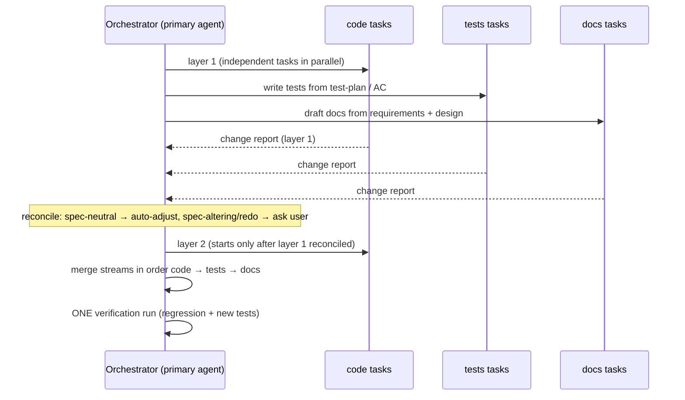

Status: Design decided — ready for /build
Issue: #79 (split from #32)
Analysis: `docs/wip/analysis-build-parallel-streams-2026-11-02.md` (loaded)
ADR: `docs/decisions/2026-11-03-build-orchestrator-streams.md`

# Design: `/build` orchestrator and parallel streams

## Overview
Replace `core/modes/build.md:42` with an orchestrator rule. The **primary session agent is the orchestrator** and spawns task agents directly, each tagged with a stream (`code`, `tests`, `docs`). Streams are a logical grouping, not agents. Works the same on every adapter; only the limits differ.

## Decisions
| # | Decision | Chosen | Why |
|---|---|---|---|
| 1 | Orchestrator | Primary session agent | Depth 1; fits Codex `max_depth = 2`; no extra agent |
| 2 | Change propagation | Return-time **change report** to orchestrator, at every **dependency-layer** boundary (not only stream end) | Works on all adapters; layer checkpoints stop late discovery and rework piling up. Rework needing a redo of finished work → ask user (REQ-5) |
| 3 | Same-repo conflicts | **File ownership**: code → source, tests → test dirs, docs → `docs/`. A stream needing another's path reports it as a change instead of editing. Merge at end, order code → tests → docs. Claude Code also uses `isolation: "worktree"` (#32) as a safety net | Conflict-free by construction, no worktree needed on Codex/Cursor/Copilot. Shared files (fixtures, config): orchestrator assigns an owner |
| 4 | Adapters / depth | **Flat model**: orchestrator spawns all task agents; no stream agent has children. Excess tasks queue at the tool's cap (Codex `max_threads = 4`). No parallel support (Copilot Free) → same layer order, sequential | Full parity (rule 6), no Codex limit change, no rule 7 migration |
| 5 | Version | Minor bump to **1.12.0**, no migration note; sync version refs (plugin.json, README, CLAUDE.md) | Behaviour change but `dist/` structure unchanged |
| 6 | Running tests | **One verification pass** after merge: full suite (regression + new). Code stream runs only existing tests for its own layer and writes no new tests. Failure → orchestrator classifies (code / test / AC wrong) and follows REQ-5 | No duplicate runs (REQ-10); no worktree sync |

## Requirement coverage
- REQ-1/2/3 → streams, layers (decision 1, 4); REQ-4/5 → decision 2; REQ-6 → per-repo split kept, each repo runs its own streams; REQ-7 → decision 3; REQ-8/9 → text in build.md (≤ 3 files no orchestrator; missing spec → tell user, stream runs after code using code as spec); REQ-10 → decision 6; REQ-11 → decision 4.

## Build tasks (not implemented here)
1. `core/modes/build.md` — replace line 42; keep tool-agnostic; keep the CLAUDE_CODE_ONLY marker after it.
2. `adapters/claude-code/build-subagent-rules.md` — worktree "per builder" → "per stream in the same repo"; merge order.
3. `adapters/codex/build.sh` (~459), `adapters/codex/setup-append.md` (~55), `docs/codex-install-and-usage.md` (~220) — flat-model wording, `spawn_agent` / `wait_agent`, thread cap.
4. `adapters/cursor-plugin/build.sh` (~235), `adapters/copilot/build.sh` (~342) — limit notes; Copilot Free sequential degrade.
5. `docs/capabilities.md` lines 98 and 267.
6. Bump version to 1.12.0; `bash plugins/pai-orbit/build.sh`.
7. `docs/architecture/constraints.md` / `system.md`: no exception added (parity kept) — only a note if the worktree wording changes.

## Irreversible decisions
None. All text; reversible by editing `core/` and rebuilding.

## Open questions
- [ ] Verify how Codex `max_threads` counts (all open agent threads vs concurrently running) before wording the queue rule — owner: Upneet Singh, blocks: Codex wording in task 3 only
- [ ] Cursor / Copilot actual parallel limits ("test per version") — owner: Upneet Singh, blocks: wording in task 4 only
