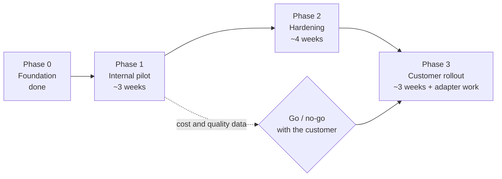

# Plan: Agentic Factory — path and plan forward

Date: 2026-11-26
Feature: `docs/features/agentic-factory/` (requirements, design, test plan)
Board: not consulted — this work was kept local at the requester's instruction, and no ticket
exists for it yet.

## The question and the answer

A customer asked whether orbit can become an "Agentic Factory": moved from a developer's PC to a
server, and autonomous from backlog to release, stopping only for questions.

**Yes.** Orbit already had the hard part, which is a disciplined workflow whose every stage writes
its output to the repo. What was missing was the machinery around it. A first version of that
machinery now exists on the branch `feat/agentic-factory` and has been run end to end on a local
board.

What the answer rests on:

- The factory runs orbit's own modes, unchanged, by starting the Claude Code CLI headless. No
  custom AI loop was written and no prompt was copied.
- A person always approves before merge and before release. Those two stops cannot be switched off.
- When the agent lacks an answer it does not guess: it posts the question on the ticket and waits.
- It runs in Docker, the same way on a laptop and on a server.

What is not yet proven is listed under "What stands between this and a customer" below.

## Where things stand

| Item | State |
|---|---|
| Requirements (14 scenarios, 44 requirements, 40 acceptance criteria) | Written |
| Design and three decision records | Written; decisions are proposed, not yet ratified by the team |
| Factory service (`factory/`) | Built: scheduler, pipeline, gates, limits, questions, hand-back, release, operator commands |
| Local board and code host | Built; used for trials and tests |
| GitHub board and code host | Built; tested against simulated `gh` output only |
| Docker image and compose file | Built and run locally |
| Tests | See `docs/features/agentic-factory/test-plan.md` for counts and results |
| Real-agent run | Done on a small fixture project with a local board; see the test plan |
| Run against a real GitHub repo | Done as a one-person, single-account trial: two tickets from issue to release, two correctly refused. Not yet done with a separate factory identity and a second person reviewing |
| Run on a real customer-sized codebase | **Not done** |

## What stands between this and a customer

1. **GitHub has been exercised only in a single-account trial.** Issues, comments, labels, pushes,
   pull requests, merges and a release all worked. Reviews by a second person and the factory
   running under its own identity (a bot account or a GitHub App) are still to do.
2. **Cost is unmeasured at real size.** The fixture ticket cost well under a dollar per stage. The
   defaults (USD 50 per ticket) are estimates with wide uncertainty.
3. **Tickets share one container.** Isolation between tickets is by directory. One container per
   ticket is needed before running tickets from more than one team or customer.
4. **Quality of unattended grooming and design is untested at scale.** The agent confirms scope from
   ticket text instead of from a person. Both optional gates should be on until this is trusted.
5. **Five answers are still needed from the customer:** their board and code host, their chat tool,
   who approves what, what "release" means for them, and how many tickets in parallel.
6. **Licensing.** A shared factory must use API-key (or Bedrock/Vertex) access, not a personal
   subscription.
7. **Where the factory lives** (this repo or its own) is proposed, not decided.

## Phases

Durations are estimates and assume two engineers. They are not commitments.

### Phase 0 — Foundation (done on the branch)

Requirements, design, the factory service, a local proof with the real agent, Docker packaging.

### Phase 1 — Internal pilot (about 3 weeks)

Goal: prove it on real work and get real numbers.

- Create a bot account and a sandbox GitHub repo; run the factory against it; fix whatever the
  GitHub adapter got wrong.
- Switch to an API key under a PSI organisation account.
- Run 10–20 small, real tickets from an internal project with both optional gates on.
- Record cost and time per stage, how many questions per ticket, how often work was sent back, and
  how the documents compare with ones a developer would have produced.
- Reset the cost and size limits from that data.
- Tune the unattended contract where the agent asked too much or too little.
- Add the factory tests to CI.

Exit: a ticket goes from `factory-ready` to a merged pull request on GitHub with only the planned
human stops, on at least 10 tickets, with measured cost.

### Phase 2 — Hardening (about 4 weeks)

Goal: safe to run for more than one team.

- One container per ticket, with a network allowlist.
- A release path that works with a protected base branch.
- Public holidays in the working calendar.
- Log and audit shipping to wherever the customer keeps logs; a simple status page if `status` on
  the command line is not enough.
- Restart, crash and limit drills on a server, not just in tests.
- A runbook for operators.

Exit: a security review of the gate and credential model passes, and a week of unattended running
on a server needs no manual repair.

### Phase 3 — Customer rollout (about 3 weeks, plus adapters)

Goal: running on the customer's project.

- Adapters for whatever the customer uses if it is not GitHub and Slack (see "Tickets on different
  platforms"). Each is one file behind an existing interface.
- Their roles, gates, limits and sensitive areas in a config file.
- Start with both optional gates on and release level `tag`; relax as trust grows.
- Hand-over: operator training and the runbook.

## Tickets on different platforms

Tickets may be on GitHub, GitLab, Jira or Azure DevOps, and the code may be on a different platform
from the tickets (Jira has no code hosting). The factory is built for that: the ticket side
("board") and the code side ("code host") are two separate adapters, chosen independently in the
config, and the pipeline uses only what every platform has.

| The factory needs | GitHub | GitLab | Jira | Azure DevOps |
|---|---|---|---|---|
| A marker a person sets | Label | Label | Label | Tag |
| Questions and answers | Issue comment | Issue note | Issue comment | Work item comment |
| "The factory has it" | Label + assignee | Label + assignee | Label + assignee | Tag + assigned to |
| Open or closed | Issue state | Issue state | Status category | State |
| Code review approval | Pull request review | Merge request approval | — (use the code platform) | Pull request vote |
| Protected base branch | Branch protection | Protected branch | — | Branch policy |
| Command line the adapter would use | `gh` | `glab` | Jira REST API | `az boards`, `az repos` |

This table is from general knowledge of these platforms and from the tools orbit's own board skill
already names. None of it has been tried from the factory; each adapter needs its own check against
the real platform.

What this means for the work:

- **Built:** GitHub for both sides (untested against GitHub), plus the local file-based pair.
- **To build, one adapter each:** GitLab board, GitLab code host, Jira board, Azure DevOps board,
  Azure Repos code host. Each is one file implementing an existing interface, with its own tests.
- **Order:** whichever the customer uses comes first. If unknown, Jira board with a GitHub or GitLab
  code host is the likeliest mixed setup.
- **Per platform, a person still does the same three things:** add one label, reply in a comment,
  approve the review. Only the screens differ.

Things that differ per platform and need a decision when each adapter is built:

- **Who is who.** Roles are lists of user names, and names differ per platform. With tickets on Jira
  and code on GitHub, the config needs each person's name on both.
- **Jira approvals.** Jira has no code review, so the merge approval always comes from the code
  platform. The release approval is a ticket comment, which works everywhere.
- **Ticket ids.** Jira ids look like `PROJ-123`. The pipeline treats ids as text, but the GitHub
  adapter accepts numbers only, which is correct for GitHub.
- **Label rules.** The default names (`factory-ready`, `factory-groomed`, and so on) avoid colons
  and spaces so they are valid everywhere, and all are configurable.

## Options considered for sequencing

| Option | Upside | Downside |
|---|---|---|
| **Pilot internally first, then the customer (recommended)** | Real cost and quality numbers before any promise; GitHub adapter proven on our own repo | The customer waits about seven weeks for a first run on their project |
| Go straight to the customer's project | Fastest visible progress for the customer | First real GitHub run, first real cost data and first unattended-quality data all happen in front of the customer |
| Build per-ticket containers before any pilot | Strongest isolation from day one | Delays learning the things most likely to change the design: cost and agent behaviour |

## Decisions needed from people

| Decision | Owner | Needed by |
|---|---|---|
| Ratify or move where the factory lives | Chetan Sharma and team | Before Phase 1 merges |
| Review the provisional defaults in `requirements.md` | Chetan Sharma | Before Phase 1 |
| Five customer questions (board, chat, approvers, meaning of release, parallelism) | Whoever speaks to the customer | Before Phase 3 scoping |
| Budget for pilot model usage | Whoever owns the budget | Before Phase 1 |
| Whether to raise board tickets for this work | Chetan Sharma | When the local-only instruction is lifted |

## Questions to send the customer

1. Which ticket board and code host do you use?
2. Which chat tool should receive alerts?
3. Who may answer the factory's questions, and who approves a merge and a release? May one person
   do both?
4. What does "release" mean for you: a tagged version, a staging deploy, or production?
5. How many tickets do you expect to be in progress at once, and how many reviewers will there be?
