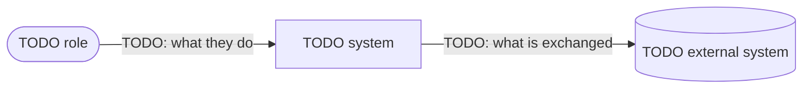
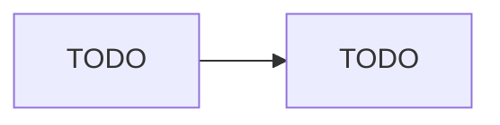

# System Architecture: {{PROJECT_NAME}}
Last updated: {{DATE}}
Status: draft

<!-- Existing codebase: run /arch init. Greenfield: run /arch define.
     System Context, Architectural Style, Decomposition, and Derived From are written by /arch define; optional after /arch init. -->

## System Context

<!-- C4 level 1: the system as one box, the people (roles) who use it, and the external systems it
     exchanges data with. Every arrow is labelled with what flows across it. -->

| Element | Kind | Interaction | Source |
|---------|------|-------------|--------|
| <!-- TODO --> | person / external system | | <!-- process lane, ux.md, domain doc --> |

## Architectural Style

<!-- Deployment topology · interaction style · internal structure, with the ADR that chose them and the revisit triggers. -->

- **Deployment topology:** <!-- TODO -->
- **Interaction style:** <!-- TODO -->
- **Internal structure:** <!-- TODO -->
- **Decided in:** <!-- docs/decisions/YYYY-MM-DD-architecture-style.md -->
- **Revisit when:** <!-- measurable trigger -->

## Decomposition

| Component | Responsibility | Owns data | Process steps | Offers | Consumes | Team |
|-----------|----------------|-----------|---------------|--------|----------|------|
| <!-- TODO --> | | | | | | |

## Services

| Service | Path / Repo | Stack | Purpose |
|---------|-------------|-------|---------|
| <!-- TODO --> | | | |

## Communication

| From | To | Protocol | Notes |
|------|----|----------|-------|
| <!-- TODO --> | | | |

## Data Stores

| Store | Type | Owned by | Notes |
|-------|------|----------|-------|
| <!-- TODO --> | | | |

## Data Flow

## Derived From

<!-- Inputs this architecture was derived from, with the commit each was read at.
     /arch update compares these against the current files to find upstream changes. -->

| Input | Path | Commit | Read on |
|-------|------|--------|---------|
| <!-- process map / ux / domain / drivers --> | | | |

## Open Questions

- [ ] <!-- Question — owner: name -->
