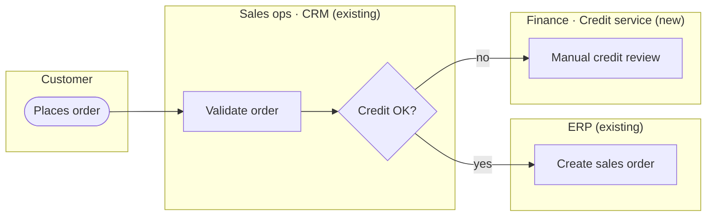

# Process Map

Model how a business process **will** work once the solution exists — who does what, in which system, in what order, and what happens when it goes wrong. A to-be process map is a solution-shaping exercise: drawing the lanes and hand-offs forces the high-level solution into view before any feature is groomed.

Use this where processes, not user journeys, drive the solution — back-office operations, multi-party workflows, integrations, approvals, settlements, fulfilment. Where a single user's journey through screens drives the solution, use `/ux` instead.

Reads from:
- `<docs root>/domain/` — `domain-knowledge.md`, `rule-engine.md`, and any other domain files: actors, business rules, constraints
- `<docs root>/architecture/system.md` — systems that already exist (if declared)
- `<docs root>/processes/` — existing process maps, for step-ID continuity and L1/L2 placement
- `<docs root>/epics/` — the parent epic, if the process belongs to one
- An as-is description the user provides (pasted notes, a document, or an existing diagram) — optional baseline

Writes to:
- `<docs root>/processes/<process-slug>.md`, created from `templates/docs/processes/PROCESS.md`

Resolve the docs root per `reference/docs-path-resolution.md` (config: `.codex/pai-orbit-config.md → ## System Docs`) before reading or writing. A to-be process usually crosses services, so in a multi-repo setup it belongs in the system docs root.

---

## When to use

| Situation | Use |
|-----------|-----|
| Several roles and systems hand work to each other to reach an outcome | `/process-map` |
| Domain knowledge already captured, solution not yet shaped | `/process-map` (reads existing domain docs — no need to redo `/domain`) |
| One rule, formula, or definition | `/domain` |
| One user moving through screens | `/ux` |
| API contracts, data model, failure handling inside a system | `/design` |

## Operations

### `create`
Usage: `/process-map create <process-name> [source]`

`source` is optional: a domain doc path or section (e.g. `docs/domain/domain-knowledge.md#settlement`) or an epic name. With no source, read all of `<docs root>/domain/`.

1. **Extract before asking.** Read the sources above. Propose, in one block:
   - **Hierarchy** — L1 (value chain area) › L2 (process group) › L3 (this process). Reuse L1/L2 names from existing files in `<docs root>/processes/` where they fit.
   - **Trigger** — the event that starts the process
   - **Outcome** — the end state that means the process succeeded
   - **Scope** — what is inside and outside this map
   - **Lanes** — every role and system involved. Tag each system lane `existing` (declared in `system.md`), `new` (does not exist yet), or `external` (third party).

   Cite the domain source behind each item. Mark anything you inferred rather than read as `Proposed`. Wait for the user to confirm or correct before going further.

2. **Walk the happy path.** Propose the steps in order, one lane-hand-off cluster at a time. For each step: actor lane, system lane, action, input, output, and the business rule that governs it (cite the domain doc). Confirm each cluster before moving on — do not dump the whole process at once.

3. **Walk the exceptions.** For each decision point and each hand-off between systems, ask what happens when it fails, times out, or is rejected. Add exception steps and paths. An exception nobody can answer becomes an open question with an owner — never a guessed path.

4. **Assign step IDs.** Format `<PREFIX>-<n>` (e.g. `OTC-3`, `OTC-3.1` for a sub-step or exception branch). The prefix is a short uppercase code for the process, confirmed with the user. IDs are permanent — see Rules.

5. **Draw the diagram** (see Diagram conventions).

6. **Derive solution implications.** This is the reason to model to-be — do not skip it:
   - **Integration points** — every hand-off between two system lanes. Each is a candidate interface for `/design`.
   - **Architecture gaps** — every `new` system lane, and any `existing` lane asked to do something `system.md` does not declare. Each is a candidate for `/arch update`.
   - **Automation and control points** — manual steps, approvals, re-keying between systems, SLAs.
   - **Feature slices** — group steps into candidate features for `/groom`, listing the step IDs each would implement.

7. **Show the full file** that will be written, then write it only after the user confirms.

### `update`
Usage: `/process-map update <process-name>`

1. Read `<docs root>/processes/<process-slug>.md`.
2. Ask what changed, or review the conversation for new decisions.
3. Present a numbered diff — steps added, changed, or retired; lanes added or removed; implications affected. Wait for confirmation before writing.
4. Set `Last updated` to today.

### `trace`
Usage: `/process-map trace <process-name>`

No writes. Read the process file, then scan `<docs root>/features/*/requirements.md` and `design.md` for its step IDs. Print a table: Step ID | Step | Features citing it. List steps no feature covers, and step IDs cited by features that no longer exist in the map (retired or mistyped).

If no operation is given, ask which: create, update, or trace. If `create` targets a process that already has a file, switch to `update`.

---

## Diagram conventions

Mermaid has no native swimlanes. Use a `flowchart LR` with one `subgraph` per lane, in the order the work flows. Node IDs are the step IDs with the hyphen replaced (`OTC_3`) so the diagram and the step table stay in sync.

````markdown

````

- `([ ])` for start and end events, `[ ]` for activities, `{ }` for decisions.
- Label each lane with the role, the system, or `role · system` when a person works inside a system. Tag system lanes `(existing)`, `(new)`, or `(external)`.
- Add a `sequenceDiagram` alongside only when the order of system-to-system messages matters more than the activity flow.
- Keep one diagram per L3 process. When it exceeds about 25 nodes, split out a sub-process with its own file and link it from a single node.

## Confidence

Every step, lane, and rule carries one of:
- **Agreed** — confirmed by the user or a named stakeholder
- **Proposed** — drafted from domain docs or inferred; not yet confirmed
- **Open** — unresolved; listed under Open questions with an owner

A to-be map is a proposal until its steps are Agreed. Never present Proposed steps as decided.

## Session close

1. **Commit.** Use `/git` to commit the process file: `docs: process-map <process-slug>`. Local commit only.
2. **Hand off.** Suggest the next mode for each implication: `/groom` for feature slices (cite step IDs in each `requirements.md`), `/design` for integration points, `/arch update` for architecture gaps, `/domain` for rules the map exposed as missing.
3. **Offer to push.** Ask: "Push this branch to remote?" Wait for explicit confirmation.

## Rules

- **Step IDs are permanent.** Never renumber. New steps take the next free number; a removed step is marked `Retired` in the step table, not deleted, so features that cite it can be traced.
- **To-be is the default.** An as-is baseline is optional context, summarised in its own section — never mixed into the to-be steps.
- **Stay at process altitude.** No screen design (that is `/ux`), no API shapes or data models (that is `/design`), no technology choices (that is `/arch`). Note such decisions as implications and move on.
- **Flag contradictions.** If a to-be step conflicts with a domain rule or a constraint in `<docs root>/architecture/constraints.md`, surface it — it is a risk, not a detail.
- Never write a process file without showing it and getting confirmation first.

---

## Appendix: docs path resolution

Referenced above as `reference/docs-path-resolution.md` — inlined here since Codex skills are flat files with no sibling-file lookup:

# Docs path resolution

Shared by every mode, skill, and agent that reads or writes project docs. Resolve once per session, reuse for every read and write in that session.

## Config

Read `.codex/pai-orbit-config.md`. If a `## System Docs` section is present, it defines `system_docs_repo` and `system_docs_path` (default `.`).

## Resolve the docs root

- No `## System Docs` section → docs root is local `docs/`.
- `system_docs_repo` is a relative path → check whether `<system_docs_repo>/<system_docs_path>` exists **and** contains at least one of the expected subdirectories (`architecture/`, `decisions/`, `domain/`, `processes/`, `features/`, `plans/`, `wip/`, `backlog/`, `reports/`, `epics/`, `ops/`). A directory that exists but holds none of these is a stale pointer, not a docs root.
  - Passes → docs root is `<system_docs_repo>/<system_docs_path>`.
  - Fails → warn once ("System docs path unreachable — continuing with local docs only") and docs root is local `docs/`.
- `system_docs_repo` is a git URL → same check against a local clone at a resolvable path. Passes → docs root is `<clone-path>/<system_docs_path>`. Fails → warn once and docs root is local `docs/`.

## Reads

Add the resolved docs root to the doc read set before starting the session.

## Writes

Every write targets `<docs root>/<relative path>` — never a hardcoded `docs/…` literal, and never with an extra interpolated `docs/` segment. The docs root already *is* the docs directory, local or remote.

Examples: `<docs root>/backlog/feature-ideas.md`, `<docs root>/features/<feature>/design.md`, `<docs root>/decisions/YYYY-MM-DD-<slug>.md`, `<docs root>/wip/session-capture-<date>.md`.

When `system_docs_path: .` (a docs repo flattened to its root), `<docs root>` is the repo root itself — writes land at `<system_docs_repo>/decisions/…`, not `<system_docs_repo>/docs/decisions/…`.
